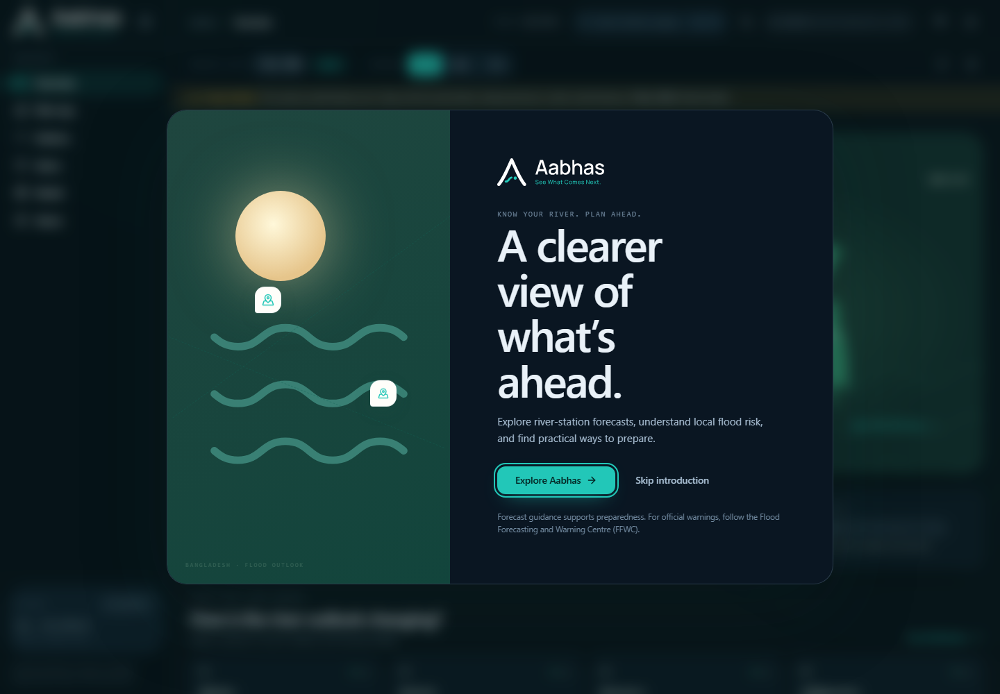
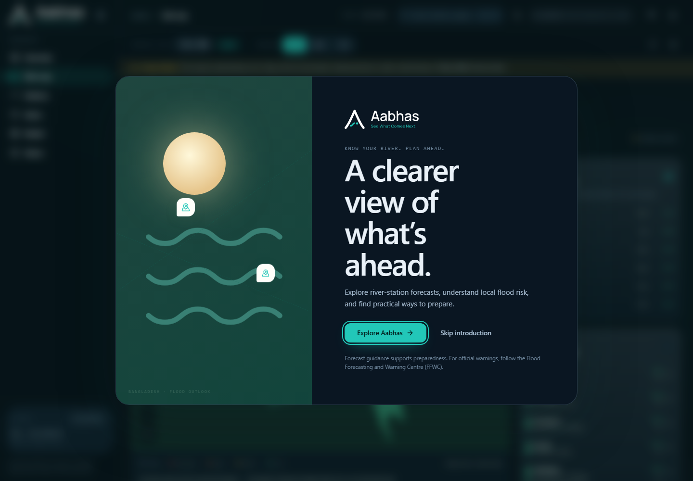
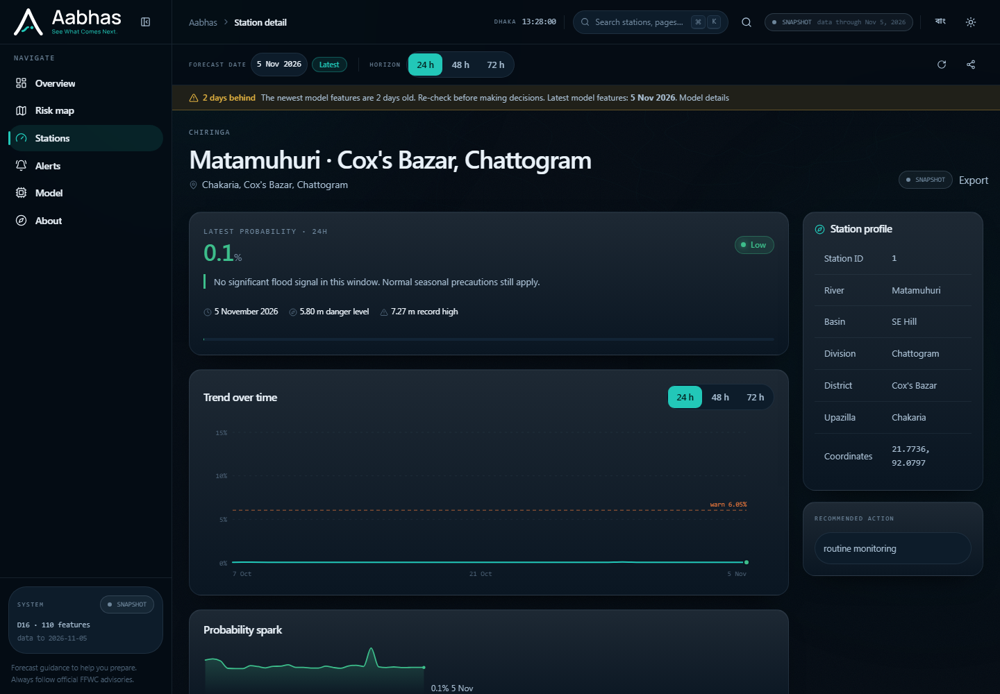
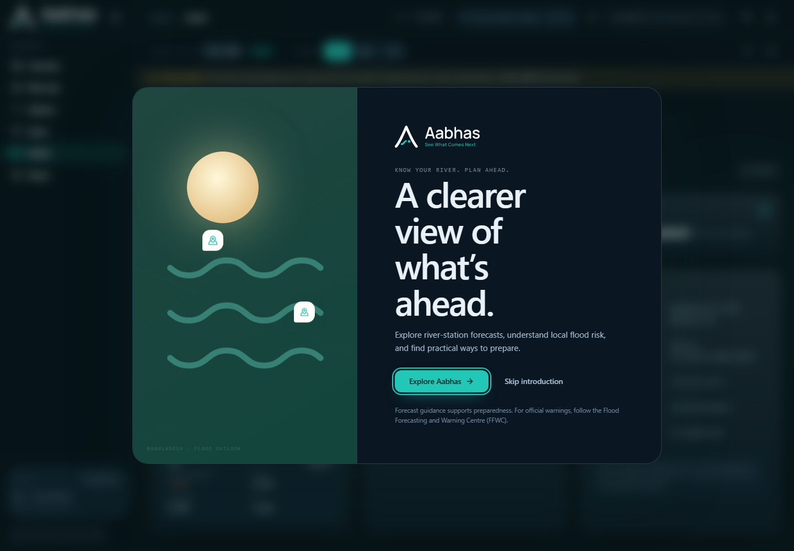
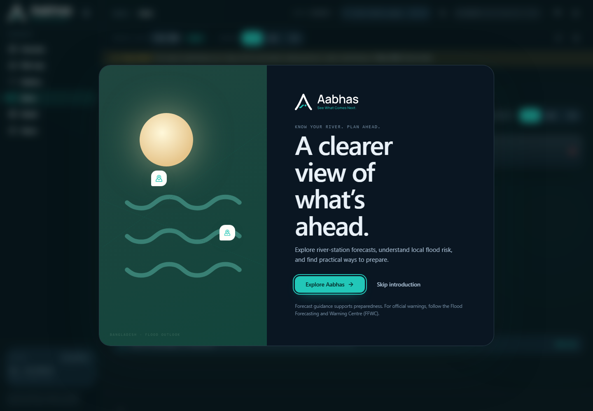
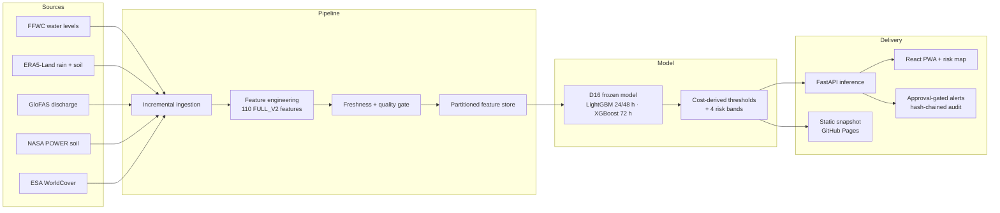

<div align="center">


# Aabhas

**Station-level, probabilistic flood outlook for Bangladesh — 24, 48 and 72 hours ahead.**

[](https://riyadh5674.github.io/Aabhas-flood-predictor-bangladesh/)
[](https://aabhas-flood-predictor-xckw.onrender.com/health)
[](https://www.python.org/)
[](system/web)
[](tests)
[](LICENSE)

</div>

---

## 🌐 Live website

### **[Open Aabhas → riyadh5674.github.io/Aabhas-flood-predictor-bangladesh](https://riyadh5674.github.io/Aabhas-flood-predictor-bangladesh/)**

No installation. No account. Opens in a browser and works on mobile.

| Surface | Link | What you get |
| --- | --- | --- |
| **Public website / PWA** | **https://riyadh5674.github.io/Aabhas-flood-predictor-bangladesh/** | Precomputed snapshot from the full local feature store — **2,622 dates, 2017-01-01 → 2026-11-10**. Always on, zero hosting cost. |
| **Live API + app** | **https://aabhas-flood-predictor-xckw.onrender.com** | Real FastAPI service running the frozen D16 model against a bundled **120-day** feature slice. Start with [`/health`](https://aabhas-flood-predictor-xckw.onrender.com/health). |
| **Source code** | **https://github.com/riyadh5674/Aabhas-flood-predictor-bangladesh** | This repository. |

> The Render free tier sleeps after inactivity, so the first API request can take about a
> minute. The GitHub Pages site has no cold start.
>
> **Aabhas is a research prototype, not an official flood-warning service.** FFWC advisories
> and government instructions always take precedence. The app labels its own data freshness and
> never presents a stale or failed request as a live forecast.

---

## The problem

Bangladesh sits at the confluence of the Ganges, Brahmaputra and Meghna. Every monsoon,
millions of people make life-or-death decisions — evacuate or stay, move livestock or protect
the harvest, open a shelter or wait — with warnings that are often district-level,
deterministic, and published too late to act on.

The question a family, a union council, an NGO or a logistics team actually asks is:

> *“What is the chance that **my station** crosses its danger level in the next
> **24 / 48 / 72 hours** — and how confident is that number?”*

Aabhas answers that question directly, at **station level**, with a calibrated probability, a
risk band, plain-language guidance and an auditable trail.

---

## What Aabhas does

| | |
|---|---|
| 🗺️ **Station-level risk map** | 153 FFWC stations mapped across Bangladesh; 133 stations in the modelling network. Risk bands for the next 24/48/72 h. |
| 📈 **Probabilistic outlook** | A calibrated probability per station and horizon — not a single binary “flood / no flood”. |
| 🚦 **Actionable bands** | Low / Moderate / High / Very high, derived from an explicit **10:1 cost of a missed flood vs. a false alarm**. |
| ⏱️ **Lead time** | 24, 48 and 72 hours, with horizon-specific thresholds and freshness checks. |
| 🧭 **Explanations** | TreeSHAP drivers per prediction, so an officer can see *why* the model raised a flag. |
| 🔔 **Approval-gated alerts** | Draft → human approval → audit log. No automatic public warning by design. |
| 🌐 **Bilingual, offline-ready** | English + Bengali UI, installable PWA, offline shell for low-connectivity areas. |
| 🧪 **Evidence-first** | Frozen test split with a disclosed read ledger, leakage audits, calibration, robustness and an 89-test contract suite. |

<div align="center">

<sub><b>Overview</b> — national situation, horizon switch (24/48/72 h), freshness banner and station-level risk bands.</sub>
</div>

<br/>

| Map | Station detail |
|---|---|
|  |  |

| Model & evidence | Alerts |
|---|---|
|  |  |

---

## Why this is credible

Aabhas was built as a **leakage-aware research programme first**, then as a product. The model
is frozen, every headline number is reproducible from committed artefacts, and the frozen-test
history is disclosed rather than simplified.

| Evidence | Result |
|---|---|
| Validation PR-AUC (`val_2022`, horizon mean) | **0.9574** (0.9708 / 0.9565 / 0.9450) |
| Frozen test PR-AUC (2023–2026) | **0.7708** vs **0.6675** for persistence |
| Beats the operational persistence baseline | **21 / 21** test cell × horizon points (minimum margin **+0.0424**) |
| Frozen-test recall at the adopted cuts | **0.918 / 0.903 / 0.856** at 24 / 48 / 72 h |
| Missed flood rows vs. persistence | **1,178 vs 2,478** pooled across horizons (**−52.5 %**) |
| Out-of-fold calibration error (ECE) | **0.0031** |
| Leakage control | 7-day embargo, station-disjoint folds, banned-feature assertions |
| Robustness | Beats persistence on **63 / 63** spatial cell × horizon points |
| Automated checks | **89 Python + 21 frontend tests**, frozen-evidence check **13 / 13** |
| Data coverage | **2,622** feature dates (2017-01-01 → 2026-11-10); **133** stations in the dataset; **81** with predictions on the latest snapshot date and **127** in the 90-day trend window |

The full scientific case — validity, calibration, ablations, error analysis and the incident
that motivated the quality gate — is in
[`reports/phase43_final_evaluation.md`](reports/phase43_final_evaluation.md) and
[`reports/phase45_thesis.md`](reports/phase45_thesis.md).

### A note on the frozen test

The programme-level ledger ([`reports/test_read_ledger.md`](reports/test_read_ledger.md))
records the full history: six exposures including two full model reads after freeze and
descriptive exposures. The reported D16 headline is the valid **MI-6** read: horizon-mean
PR-AUC **0.77076**, described as the **max-over-two-full-reads** at programme level. D17/V4
hybrids were retracted by D18 and must not be cited or deployed; **D16 remains champion**.
Any future test read must be pre-registered and added to the ledger.

### What makes it different

1. **Probabilistic, station-level, multi-horizon** — useful for pre-positioning, not just alerting.
2. **Cost-aware thresholds** — the false-alarm/miss trade-off is explicit policy, not a hidden default.
3. **Leakage discipline** — most flood-ML demos report inflated scores from label-window leakage. Aabhas documents and tests against it.
4. **Operational honesty** — source-freshness telemetry, a hard quality gate, a frozen model and a human-in-the-loop alert workflow.
5. **Deployable on free infrastructure** — a static snapshot for the public, a FastAPI service for a live demo, one Docker image for a paid host.

---

## Architecture



Full component map, data contracts and deployment topology:
[`docs/ARCHITECTURE.md`](docs/ARCHITECTURE.md).

---

## Try it in 60 seconds

### Option A — public demo (no install)

1. Open **https://riyadh5674.github.io/Aabhas-flood-predictor-bangladesh/**.
2. Pick a date and a horizon (24 / 48 / 72 h).
3. Select a station or use the map.
4. Read the probability, risk band, drivers and freshness banner.

For the live API, start with **https://aabhas-flood-predictor-xckw.onrender.com/health**.
The first request may take about a minute on Render's free tier.

### Option B — run the full stack locally

```powershell
# 1. Python environment (once)
py -3.13 -m venv .venv
.\.venv\Scripts\python.exe -m pip install -r requirements.txt

# 2. Frontend dependencies (once)
cd system\web; npm ci; cd ..\..

# 3. Start API + web app together
cd system\web; npm run dev
```

Open **http://localhost:5173**. The launcher starts the FastAPI service on port 8000 if it is
not already running. For static-snapshot mode:

```powershell
cd system\web
$env:VITE_AABHAS_STATIC_SNAPSHOT="true"
npm run dev
```

### Option C — Docker Compose

```bash
docker compose up --build
# web: http://localhost:5173   api: http://localhost:8000/health
```

The 5-minute walkthrough with talking points is in [`docs/DEMO.md`](docs/DEMO.md).

---

## Repository layout

```
├── src/                     Research library (ingestion, features, models, evaluation)
├── notebooks/               Retained research notebooks + retention notes
├── reports/                 One report per phase, metric CSVs, frozen evidence
├── figures/                 Paper and analysis figures
├── models/final_v2/         Frozen production model (D16) + config
├── scripts/                 Trainers, auditors, freeze checker, deployment scripts
├── system/
│   ├── api/                 FastAPI inference server
│   ├── web/                 React 19 + Vite + TypeScript PWA
│   ├── config/              Model, alert and ingestion configuration
│   ├── ingestion/           FFWC, Open-Meteo, GloFAS, ERA5, POWER, WorldCover
│   ├── features/            Feature pipeline + mandatory quality gate
│   ├── alerts/              Early-warning engine, approval lifecycle, audit log
│   ├── deploy/              Static snapshot builder + host publishers
│   ├── ops/                 Daily pipeline, refresh/publish, scheduler
│   └── map/                 Choropleth risk-map generator
├── tests/                   89 Python contract/regression tests
├── docs/                    Pitch, demo, architecture, operations and governance docs
└── DEPLOYMENT.md            Runbook, CI/CD, troubleshooting
```

---

## Verification

```powershell
# Python suite — 89 tests
.\.venv\Scripts\python.exe tests\run_tests.py

# Frozen evidence — 13/13 checks, 0 changed files
.\.venv\Scripts\python.exe scripts\freeze_results.py --check

# Frontend — 21 unit tests, typecheck and production build
cd system\web
npm run typecheck
npm run test
npm run build
```

Run the API on its own (the dev launcher normally does this for you):

```powershell
.\.venv\Scripts\python.exe system\api\run_api.py --port 8000
```

Current verified state (2026-11-10): **89/89 Python tests**, **21/21 frontend tests**,
**freeze 13/13**, quality gate green, public website HTTP 200, live API `/health` HTTP 200 with
`model_loaded: true` and `degraded: false`.

---

## Documentation

| Document | What it covers |
|---|---|
| [docs/FREE_TIER_OPERATIONS.md](docs/FREE_TIER_OPERATIONS.md) | What runs free, what is manual, and the exact GitHub Actions / Render / Pages setup |
| [DEPLOYMENT.md](DEPLOYMENT.md) | Full runbook: Render, Docker, CI/CD, daily refresh, troubleshooting |
| [docs/ARCHITECTURE.md](docs/ARCHITECTURE.md) | System design, data contracts, deployment topology, security controls |
| [reports/phase43_final_evaluation.md](reports/phase43_final_evaluation.md) | Scientific validity assessment |
| [reports/phase45_thesis.md](reports/phase45_thesis.md) | Thesis-style research report |
| [reports/test_read_ledger.md](reports/test_read_ledger.md) | Programme-level frozen-test read history |
| [docs/THRESHOLD_SIGN_OFF.md](docs/THRESHOLD_SIGN_OFF.md) | Threshold governance and the signed research-prototype decision |
| [docs/DUTY_OFFICER_PROCESS.md](docs/DUTY_OFFICER_PROCESS.md) | Alert review, approval and escalation runbook |
| [docs/PITCH.md](docs/PITCH.md) | Partner / investor brief: problem, product, evidence, roadmap |
| [docs/DEMO.md](docs/DEMO.md) | 5-minute demo script and stakeholder talking points |
| [REPRODUCE.md](REPRODUCE.md) | Paper reproduction levels A–E and freeze verification |
| [FLAWS.md](FLAWS.md) | Hardening status, resolved issues, remaining risks |
| [models/README.md](models/README.md) | Which model binaries are retained, and the D17 retraction |
| [notebooks/README.md](notebooks/README.md) | Retained notebooks and the authoritative evidence for pruned ones |
| [final workflow.md](final%20workflow.md) | Complete 45-phase research workflow (73 stages) |

---

## Status and honest boundary

| Area | Status |
|---|---|
| Research programme | ✅ Complete — 45 phases / 73 stages at the research-prototype level |
| Frozen model | ✅ D16, hash-checked; test closed for this paper |
| Public static website | ✅ Live on GitHub Pages, snapshot through 2026-11-09 |
| Live API | ✅ Live on Render free, 120-day demo slice through 2026-11-05 |
| Free-tier daily refresh | ⚙️ Implemented; scheduled workflow is opt-in until secrets/variables are set |
| External threshold sign-off | ⏳ Internal research sign-off done; agency/hydrology/legal sign-off pending |
| Alert delivery | ⏳ Lifecycle implemented; SMTP/webhook disabled and no recipient configured |
| Managed always-on hosting | ⏳ Not configured; needed for an SLA |

The honest boundary: the **model and system are complete at the research-prototype level**. What
remains is **operational** — managed always-on scheduling, external sign-off, delivery
credentials, and an institutional partner to receive approved alerts. See
[`FLAWS.md`](FLAWS.md) O-01/O-02 and [`docs/THRESHOLD_SIGN_OFF.md`](docs/THRESHOLD_SIGN_OFF.md).

---

## Roadmap

| Phase | Status | What it unlocks |
|---|---|---|
| Research + prototype | ✅ Complete | Frozen model, full evaluation, working product, tests |
| Public static demo | ✅ Live | Shareable link for stakeholders, zero hosting cost |
| Live API demo | ✅ Live | Real inference path on free infrastructure |
| Free-tier daily refresh | ⚙️ Ready, opt-in | Automatic data updates without a paid runner |
| Pilot with an agency / NGO | 🔜 Next | Signed MOU, named duty officer, external threshold sign-off, real delivery channel |
| Always-on managed deployment | 🔜 Next | Cloud Run / paid Render + managed scheduler; needs modest funding |
| Multi-country transfer | 🔬 Planned | Domain adaptation to other delta systems (first experiment was negative — documented) |
| Impact evaluation | 🔬 Planned | Prospective evaluation of decisions and lead time saved |

---

## Data sources and acknowledgements

- **FFWC Bangladesh** — station water levels and danger levels
- **Open-Meteo** — ERA5-Land rainfall, temperature and soil moisture
- **Copernicus GloFAS** — transboundary river discharge
- **NASA POWER** — soil moisture reanalysis
- **ESA WorldCover** — land-cover features
- **geoBoundaries** — administrative boundaries

Thank you to the open-data teams who make this work possible.

---

## Citation

```bibtex
@software{aabhas2026,
  title  = {Aabhas: Leakage-Aware Probabilistic Flood Forecasting for Bangladesh},
  year   = {2026},
  url    = {https://github.com/riyadh5674/Aabhas-flood-predictor-bangladesh},
  note   = {Research prototype; not an official flood-warning service}
}
```

A machine-readable citation is in [`CITATION.cff`](CITATION.cff).

## Contributing and security

Contributions are welcome — read [CONTRIBUTING.md](CONTRIBUTING.md) and
[CODE_OF_CONDUCT.md](CODE_OF_CONDUCT.md). Please report vulnerabilities privately per
[SECURITY.md](SECURITY.md), never in a public issue.

## License

MIT — see [LICENSE](LICENSE).

---

<div align="center">

**Aabhas** · *Know your river. Plan ahead.*

[**Live website**](https://riyadh5674.github.io/Aabhas-flood-predictor-bangladesh/) ·
[**Live API**](https://aabhas-flood-predictor-xckw.onrender.com/health) ·
[**GitHub**](https://github.com/riyadh5674/Aabhas-flood-predictor-bangladesh)

Built in Bangladesh, for Bangladesh — and for every delta facing the same question.

</div>
