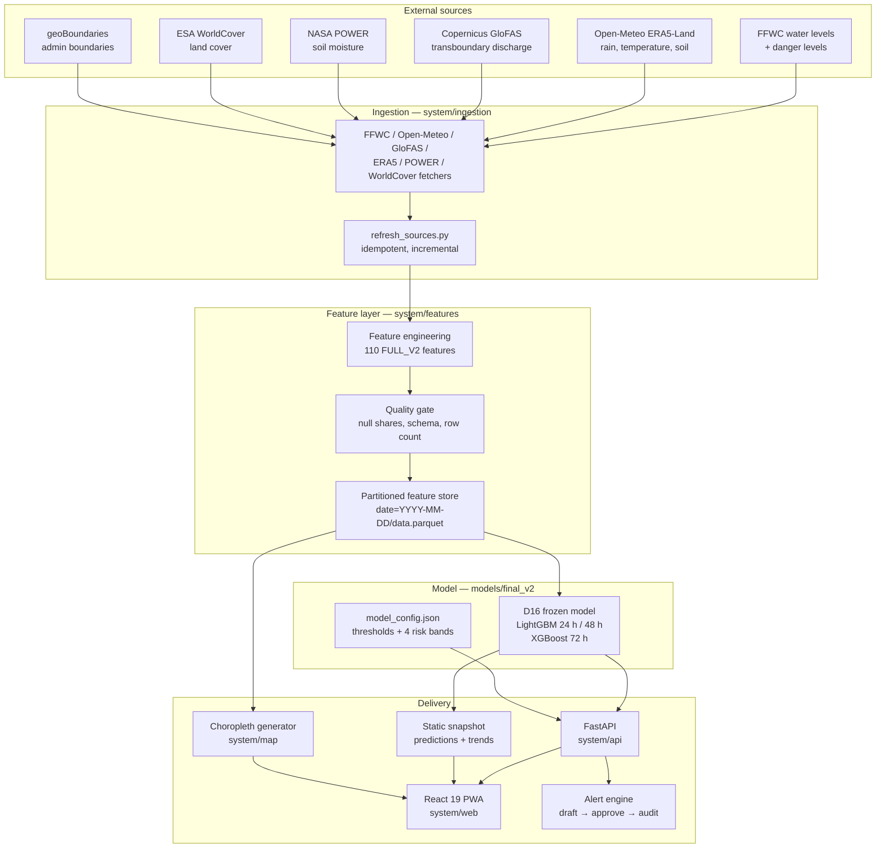

# Architecture

**Aabhas — Flood Outlook for Bangladesh**

This document is the engineering map. For the scientific case see
[`reports/phase43_final_evaluation.md`](../reports/phase43_final_evaluation.md); for the
deployment runbook see [`DEPLOYMENT.md`](../DEPLOYMENT.md).

---

## 1. Design principles

| Principle | What it means in the code |
|---|---|
| **Model immutability** | D16 is frozen. Runtime code never retrains or reweights. Artefacts are SHA-256 tracked in `reports/freeze_manifest.json`. |
| **Per-station isolation** | Results are computed per station-date. Stations are never pooled; one station's bad data cannot contaminate another. |
| **Fail safe, not silent** | Missing or stale inputs fail the quality gate and surface in `/health` and the UI, never as a plausible-looking forecast. |
| **Idempotent ingestion** | Re-running a date produces the same partitions. Fetchers are incremental and skip complete dates. |
| **Auditability** | Predictions, alerts, approvals and deliveries carry provenance and timestamps. |
| **Same code, two delivery modes** | The UI runs against the FastAPI API or a precomputed static snapshot, with a shared contract. |

---

## 2. Component map



---

## 3. Data flow

```
external source
  → raw cache (system/data/raw/, gitignored)
  → source freshness check (system/data/processed/source_status/<date>.json)
  → feature build for date t
  → quality gate (system/data/processed/quality/<date>.json)
  → feature store partition (date=t/data.parquet)
  → model.predict(frame, horizon)
  → probability + threshold + risk band
  → API response / static snapshot / alert draft
```

### Data contracts

| Contract | Rule |
|---|---|
| **Label** | `label_h = 1` iff any observed water level in `(t, t+h]` is at or above the station danger level. Missing stays `NaN`, never `0`. |
| **Feature ban** | `obs_days_*` label-window columns and label columns are never features; asserted absent in tests. |
| **Split** | Train < 2022, validation 2022, test 2023+. 7-day embargo between segments. |
| **Spatial CV** | 5 station-disjoint folds; fold 0 is the holdout network. |
| **Feature store** | One Parquet partition per date, 110 FULL_V2 columns, keyed by `station_id`. |
| **Snapshot** | Derived predictions only — no model or raw data is shipped to the browser. |

---

## 4. Model

| Property | Value |
|---|---|
| Name | **D16** |
| Family | Per-horizon gradient boosting — LightGBM (24 h, 48 h), XGBoost (72 h) |
| Features | FULL_V2, 110 columns |
| Target | `P(flood at station within horizon)` |
| Validation PR-AUC | 0.9574 horizon mean |
| Test PR-AUC | 0.7708 (persistence: 0.6675) |
| Calibration | Out-of-fold ECE 0.0031 |
| Threshold source | `reports/phase29_chosen_thresholds.csv`, cost ratio C_FN:C_FP = 10:1 |
| Frozen artefacts | `models/final_v2/selected_model_v2.pkl`, `final_config_v2.json` |

Risk bands are derived from the cost-derived warning threshold and the calibrated
probability. They are exposed through `/thresholds` and mirrored in
`system/config/model_config.json`; the UI never hard-codes them.

---

## 5. API surface

| Endpoint | Purpose |
|---|---|
| `GET /health` | Model readiness, feature coverage, per-source freshness, degraded flag |
| `GET /model/info` | Frozen model identity and metadata |
| `GET /thresholds` | Thresholds and risk bands per horizon |
| `GET /dates` | Available feature-store dates |
| `GET /predict` | One station, one date, one horizon |
| `POST /predict/batch` | Many stations in one call |
| `GET /predict/all` | All stations for a date and horizon |
| `GET /predict/trend` | Batched daily trend for a station (max 60 dates) |
| `GET /alerts/feed` | Draft and approved alert records |
| `POST /alerts/evaluate` | Evaluate bands → alert drafts (admin key) |
| `POST /alerts/{id}/approve` | Human approval (admin key) |
| `GET /monitoring` | Operational monitoring summary |
| `GET /monitoring/prometheus` | Prometheus-format metrics |
| `POST /admin/*` | Pipeline trigger, model reload, status (admin key) |

**Security controls:** security headers and CSP, request IDs, gzip, CORS allow-list,
sliding-window rate limiting, optional admin key, bounded request sizes, no secrets in
the client. See [`FLAWS.md`](../FLAWS.md) R-01/R-02.

---

## 6. Deployment topologies

### A. Static public demo (free, current)

```
GitHub Actions build → snapshot + Vite build → GitHub Pages (gh-pages)
                                   └─ no server, no API cost
```

Used for: stakeholder demos, GitHub Pages, Hugging Face Static Space.
Limitation: no live prediction, no alert delivery.

### B. Single-container live deployment (current)

```
Docker image
  ├── FastAPI (uvicorn) on $PORT
  ├── frozen D16 model (models/final_v2/selected_model_v2.pkl)
  ├── bundled 120-day feature store (system/data/demo/model_ready/)
  └── compiled SPA (dist/)
        └── same origin, no CORS
```

Used for: Render / Cloud Run / any Docker host. The bundled slice makes the image
self-contained; `AABHAS_FEATURE_STORE` or `HF_FEATURE_DATASET` can point at the full
2,617-date store when available. Environment variables and the full runbook are in
[`DEPLOYMENT.md`](../DEPLOYMENT.md).

### C. Daily data refresh

```
system/ops/daily_pipeline.py
  1. refresh_sources.py   (GloFAS, POWER soil, ERA5)
  2. ingestion            (FFWC, rainfall, features)
  3. quality gate         (hard fail unless --allow-degraded)
  4. publish              (snapshot / HF dataset / dashboard)
```

Scheduling options: Windows Task Scheduler (local), GitHub Actions cron
(`.github/workflows/refresh.yml`), or a managed cloud scheduler (needs credentials).

---

## 7. Frontend

| Area | Implementation |
|---|---|
| Framework | React 19 + TypeScript + Vite |
| State / data | Context for theme, language, date, horizon, mode; React Query for fetching |
| Routing | Hash routing in static-snapshot mode; browser routing behind a server |
| Map | `d3-geo` choropleth + station markers |
| Accessibility | Keyboard command palette, focus management, ARIA labels, colour + pattern cues |
| Offline | Service worker with base-aware paths, offline shell, manifest |
| i18n | English and Bengali |
| Tests | 21 Vitest unit tests for freshness, risk bands, formatting and aggregation |

Build-time switches:

| Variable | Effect |
|---|---|
| `VITE_API_BASE` | API origin for live mode |
| `VITE_AABHAS_STATIC_SNAPSHOT=true` | Serve precomputed data, no API |
| `AABHAS_BASE` | Serve from a sub-path (e.g. GitHub Pages project site) |
| `AABHAS_SOURCEMAP=false` | Smaller production bundle |
| `VITE_AABHAS_ALLOW_DEMO=true` | Enable synthetic demo values outside development |

---

## 8. Reliability and failure modes

| Failure | Behaviour |
|---|---|
| One source stale | Source marked degraded in `/health`; date fails the quality gate unless explicitly allowed |
| Feature partition missing | The date is absent from `/dates`; the UI disables it |
| Model artefact missing | API reports not ready; no prediction is fabricated |
| API unreachable (static build) | Snapshot serves with an explicit freshness banner |
| API unreachable (live build) | Error state with retry; demo values only if explicitly enabled |
| Alert delivery failure | Draft remains in the approval queue; delivery adapters are disabled by default |

The guiding rule: **a user must never mistake a degraded system for a confident
forecast.**

---

## 9. Repository conventions

```
src/            research library
system/         deployable application
tests/          contract and regression tests (84)
reports/        phase reports + frozen CSVs
scripts/        training, auditing and deployment entry points
docs/           pitch, demo, architecture, governance
figures/        publication figures
```

- Frozen outputs are never edited in place. Changes go through a script and a new
  manifest revision.
- `AABHAS_ROOT` or file-relative resolution replaces hard-coded machine paths.
- The test split is closed; any script that reads it must log the read in
  `reports/test_read_ledger.json`.

---

## 10. Non-goals

- Replacing FFWC or any official warning authority.
- Fully automatic public warning delivery.
- Real-time (< 1 h) nowcasting; the product is a daily outlook.
- Basin-wide hydrodynamic simulation — the model is statistical, not physics-based.

These boundaries are deliberate and are stated in the product UI.
